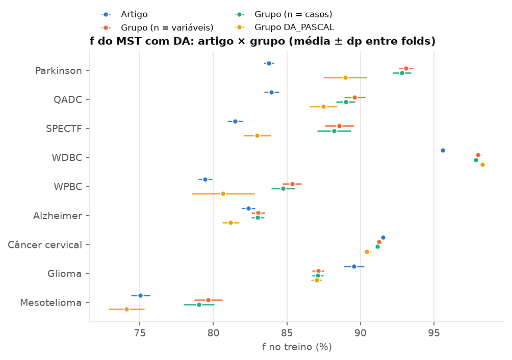
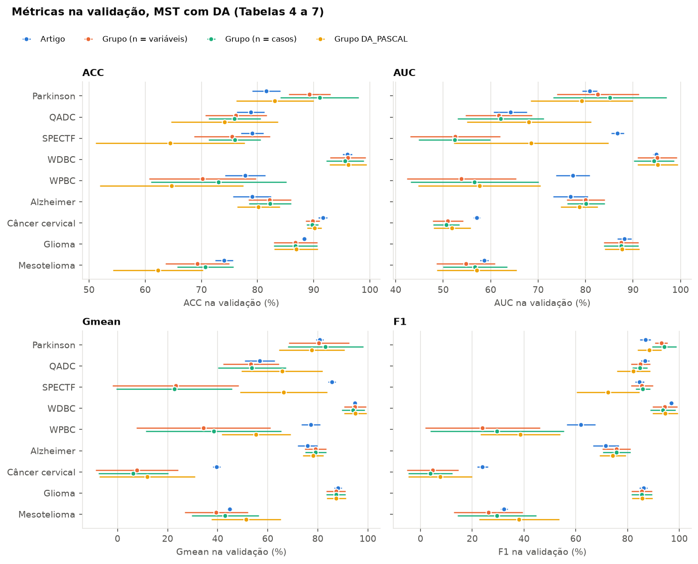
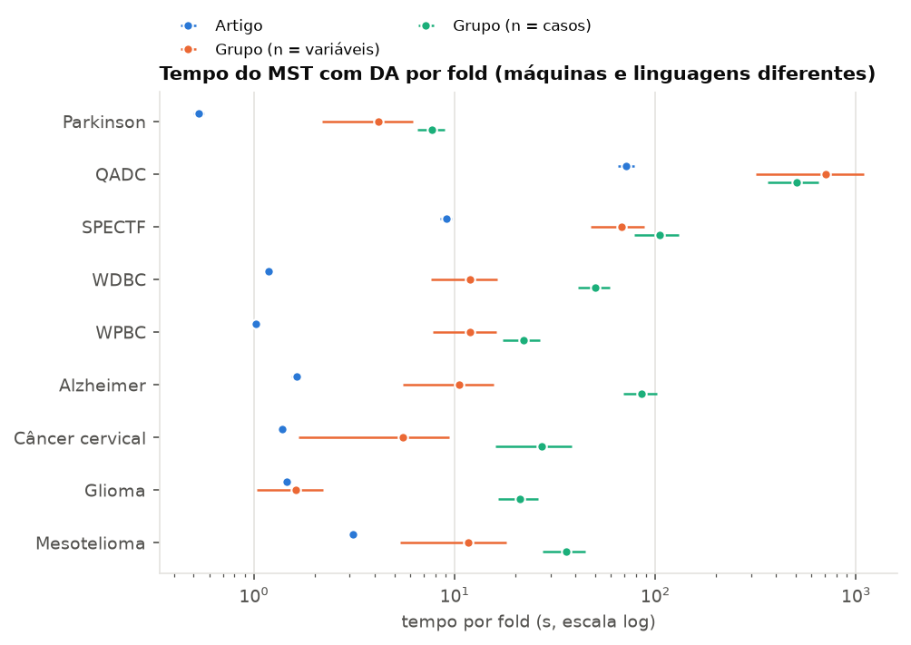
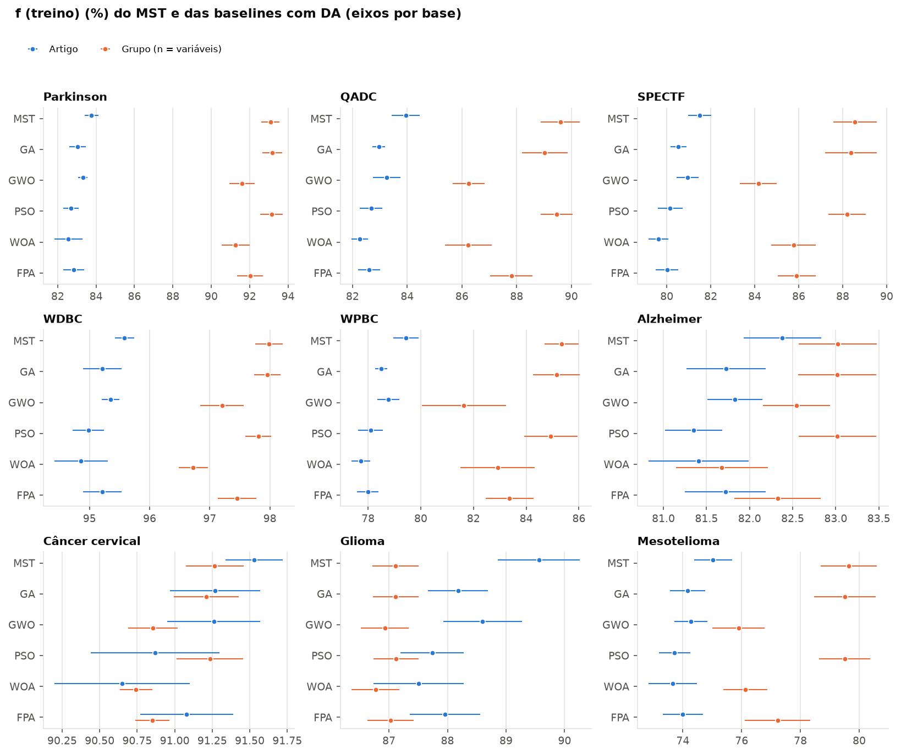
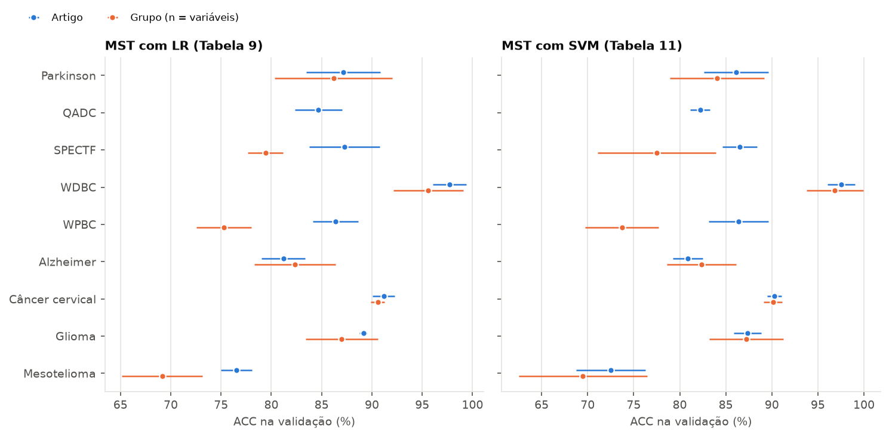

# Resultados: MultiStartTabu (MST) e extensão MST_FREQ

Grupo 5, Inteligência Artificial. Reprodução de Pacheco et al. (2023, *Scientific
Reports* 13:17140) com a extensão do grupo (memória de longo prazo por frequência).
Todas as execuções, decisões e tabelas completas estão em `results/` (veja o índice no
fim). Valores de `f`, ACC, AUC, Gmean e F1 em %. Cada linha "média ± desvio" é
calculada entre os 10 folds, como no artigo; com várias sementes, cada fold entra com
a média das suas sementes.

## Resumo

- **O que rodou:** cerca de 6 300 execuções em 10 campanhas (E0, E1, E1-casos, E1b,
  E2-P1, E2a, E2-P2, E3, E4, E5), todas completas. E1, E1-casos, E2-P1, E2-P2 e E3 com 5
  sementes; baselines e LR/SVM do E4 com 1 semente (como no artigo). Classificador principal: DA (LDA).
- **Decisões:** `scale_base = variaveis` (E0; desvio declarado do texto do artigo,
  medido pelo E1-casos); λ = 0,05 e gatilho = 5 (E2a); pré-processamento das bases
  em `data/NOTES.md`; demais decisões em `results/DECISOES.md` (D1 a D10).
- **Três achados principais:**
  1. **A extensão MST_FREQ é neutra.** Com orçamento igual (P2), não há diferença
     significativa de `f` nem de métricas de validação em relação ao MST em nenhuma
     base (Wilcoxon com Holm, todos os p ≥ 0,5). A diversidade entre reinícios sobe
     um pouco, sem significância em P2 e com significância em 4 bases em P1.
  2. **A lista tabu é o que faz o MST funcionar; os reinícios ajudam pouco.** Sem
     lista tabu, a busca entra em ciclo e perde de 0,2 a 5,3 p.p. de `f`. Com uma
     única construção, perde no máximo 0,4 p.p. O MST escapa de 28% a 41% dos máximos
     locais por onde passa.
  3. **O `f` do grupo fica acima do artigo em 7 das 9 bases (até +9,3 p.p.), mas a
     validação não acompanha.** Explicação mais provável: nas bases desbalanceadas,
     o DA com o termo de prioris leva a solução para "prever a classe majoritária": a acurácia de treino
     sobe e AUC e Gmean caem. O DA com prioris iguais (regra do código Pascal dos
     autores) deixa a diferença em `f` abaixo de 2 p.p. em 5 bases.

---

## Seção 3.3: leitura de `n` em `tenure = n/2` e `maxiterTS = 10·n` (E0)

O texto do artigo define `n` como o número de **casos** de treino. O código Pascal
público dos autores dimensiona as listas tabu pelo número de **variáveis**. O E0
comparou as duas leituras (MST, DA, Parkinson, WPBC e QADC, 10 folds × 2 sementes,
120 execuções).

| base | leitura | tenure | maxiterTS | f treino (%) | tempo (s) | iter. locais | iterações sem movimento admissível |
|---|---|---|---|---|---|---|---|
| Parkinson | casos | 87 | 1755 | 92,79 ± 0,60 | 5,2 | 20 185 | 76,0% |
| Parkinson | variáveis | 11 | 220 | 93,08 ± 0,47 | 7,6 | 3 320 | 0% |
| WPBC | casos | 89 | 1780 | 84,69 ± 0,83 | 25,3 | 25 577 | 66,2% |
| WPBC | variáveis | 15 | 310 | 85,37 ± 0,62 | 82,4 | 6 871 | 0% |
| QADC | casos | 129 | 2580 | 89,03 ± 0,67 | 657,8 | 40 838 | 50,1% |
| QADC | variáveis | 32 | 650 | 89,56 ± 0,64 | 2 666,1 | 15 549 | 0% |

**Critério** (definido antes de rodar): trocar para `variaveis` se, com `casos`, mais
de 50% das iterações ficarem sem movimento admissível **e** o `f` não for melhor.

**Resultado:** com `casos`, 60,9% das iterações ficam sem movimento admissível, e o
`f` médio é 88,84% contra 89,34% com `variaveis`. Pareando por (fold, semente),
`variaveis` vence em 44 dos 60 pares, `casos` em 3, e 13 empatam. Uma sonda nas
outras seis bases dá de 64% (SPECTF) a 96% (Alzheimer) de iterações paradas com
`casos`. **Decisão: `scale_base = variaveis`** em todos os experimentos seguintes. É um
desvio declarado do texto do artigo. Para medir o efeito dele, o E1 também foi rodado
com a leitura literal (E1-casos; veja a comparação com o artigo).

**O que isso diz sobre `tenure = n/2`:** com `n` = casos, o tenure (87 a 696) passa
do número de variáveis (22 a 65) em todas as bases. Depois de cerca de `m`
movimentos, toda variável está tabu, e a busca só se move por aspiração, quando o
vizinho supera `f*`. As demais iterações passam sem movimento. Lida ao pé da letra,
a regra transforma a Busca Tabu numa subida de encosta com longas esperas. Com
`n` = variáveis, o tenure fica entre 11 e 32: a lista tabu bloqueia cerca de metade
das variáveis e sempre sobra movimento admissível.

---

## Comparação com o artigo

Gerado por `python -m reports.comparacao`. Os gráficos e as tabelas completas estão
em `results/relatorio/comparacao/` (`comparacao.md`). As tabelas do artigo foram
transcritas em `reports/artigo.py`, e os testes em `tests/test_artigo.py` conferem a
transcrição.

### Função objetivo do MST com DA (Tabela 3)

| base | artigo | grupo, n = variáveis (E1) | grupo, n = casos (E1-casos) | grupo, DA com prioris iguais (E1b) | dif. E1 (p.p.) | dif. E1-casos | dif. E1b |
|---|---|---|---|---|---|---|---|
| Parkinson | 83,76 ± 0,36 | 93,08 ± 0,48 | 92,80 ± 0,63 | 88,95 ± 1,48 | +9,32 | +9,04 | +5,19 |
| QADC | 83,95 ± 0,51 | 89,60 ± 0,71 | 88,98 ± 0,63 | 87,47 ± 0,94 | +5,65 | +5,03 | +3,52 |
| SPECTF | 81,49 ± 0,52 | 88,56 ± 0,99 | 88,20 ± 1,13 | 82,97 ± 0,92 | +7,07 | +6,71 | +1,48 |
| WDBC | 95,58 ± 0,16 | 97,98 ± 0,23 | 97,84 ± 0,21 | 98,29 ± 0,22 | +2,40 | +2,26 | +2,71 |
| WPBC | 79,44 ± 0,48 | 85,34 ± 0,64 | 84,73 ± 0,80 | 80,66 ± 2,13 | +5,90 | +5,29 | +1,22 |
| Alzheimer | 82,38 ± 0,45 | 83,02 ± 0,45 | 83,01 ± 0,44 | 81,17 ± 0,58 | +0,64 | +0,63 | −1,21 |
| Câncer cervical | 91,53 ± 0,19 | 91,27 ± 0,19 | 91,15 ± 0,21 | 90,42 ± 0,25 | −0,26 | −0,38 | −1,11 |
| Glioma | 89,56 ± 0,70 | 87,11 ± 0,39 | 87,09 ± 0,39 | 87,01 ± 0,37 | −2,45 | −2,47 | −2,55 |
| Mesotelioma | 75,03 ± 0,64 | 79,65 ± 0,96 | 79,00 ± 1,04 | 74,08 ± 1,22 | +4,62 | +3,97 | −0,95 |

**Leitura de `n`:** usar a leitura literal do artigo (`casos`) muda pouco: reduz a
diferença em até 0,7 p.p. A leitura de `n` não explica a distância até o artigo.

**Explicações prováveis para as diferenças acima de 1 p.p.** Nenhuma foi confirmada:
o código completo usado no artigo não foi publicado.

- **Regra de decisão do DA (Parkinson, QADC, SPECTF, WPBC, Mesotelioma).** O DA do
  projeto inclui o termo log(π₁/π₀) das prioris; o código Pascal público dos autores
  não inclui. Nas bases desbalanceadas, com o termo de prioris o DA tende a prever a
  classe majoritária, o que aumenta a acurácia no treino e, portanto, `f`. Com
  prioris iguais (E1b), a diferença cai de 7,1 para 1,5 p.p. no SPECTF, de 5,9 para
  1,2 no WPBC e de 4,6 para −1,0 no Mesotelioma. É a explicação mais forte.
- **Parkinson (+5,2 p.p. mesmo com prioris iguais).** A Tabela 1 traz 46/146 casos,
  que somam 192, e não 195 (provável erro de digitação). Fora isso, não achamos
  causa.
- **QADC (+3,5 p.p. com prioris iguais).** Temos 65 variáveis, e o artigo 67. As 2
  variáveis que faltam não foram identificadas (`data/NOTES.md`). As alternativas
  com 67 ou mais variáveis incluem os rótulos dos especialistas e vazam a classe.
- **WDBC (+2,4 p.p.).** A base bate exatamente com a Tabela 1. A normalização não
  explica, porque a LDA é invariante a mudanças de escala das variáveis. A causa
  provável é algum detalhe da implementação do DA (tratamento de matriz singular,
  regra de desempate) ou da contagem de acertos.
- **Glioma (−2,5 p.p., o grupo abaixo do artigo).** A base tem variáveis
  categóricas (raça, mutações). O artigo pode ter codificado raça de outra forma
  (por exemplo, com variáveis indicadoras), o que muda o espaço de busca. Nossa
  leitura segue o arquivo da UCI sem mudança.
- **Desvios-padrão do artigo.** Os desvios de `f` no artigo (0,16 a 0,70) são
  parecidos com os nossos. Já os desvios das métricas de validação são muito
  menores que os nossos (por exemplo, AUC do SPECTF: ±1,31 contra ±9,47). Com 10
  folds de 20 a 30 casos, uma única troca de classificação muda a acurácia em 3 a 5
  p.p., o que torna esses desvios pequenos difíceis de explicar.

### Métricas na validação (Tabelas 4 a 7)

ACC, AUC, Gmean e F1 do grupo ficam próximos do artigo em WDBC, Alzheimer e Glioma.
Ficam muito abaixo em SPECTF, WPBC, Câncer cervical e Mesotelioma. Exemplo: o Gmean
do SPECTF é 23,2% contra 85,7% no artigo. Nessas bases, o classificador escolhido
pelo MST quase nunca acerta a classe minoritária: AUC ≈ 50%, mesmo efeito da regra
de prioris descrito acima. Com prioris iguais (E1b), o Gmean sobe (SPECTF 66,3%,
WPBC 55,4%, Mesotelioma 51,4%), sem chegar ao artigo. Tabelas completas em
`relatorio/comparacao/comparacao.md`, seção 2.

### Tempo (Tabela 2)

| base | artigo (Pascal, i9-10920X) | grupo MST | grupo MST_FREQ |
|---|---|---|---|
| Parkinson | 0,53 ± 0,03 | 4,2 ± 2,0 | 5,5 ± 2,2 |
| QADC | 71,75 ± 6,49 | 706,5 ± 390,0 | 770,4 ± 372,7 |
| SPECTF | 9,09 ± 0,62 | 67,5 ± 20,1 | 68,3 ± 20,0 |
| WDBC | 1,19 ± 0,02 | 11,9 ± 4,3 | 14,7 ± 3,9 |
| WPBC | 1,02 ± 0,04 | 12,0 ± 4,2 | 12,4 ± 4,1 |
| Alzheimer | 1,63 ± 0,09 | 10,6 ± 5,1 | 13,7 ± 4,9 |
| Câncer cervical | 1,39 ± 0,02 | 5,5 ± 3,8 | 5,5 ± 3,7 |
| Glioma | 1,46 ± 0,06 | 1,6 ± 0,6 | 1,6 ± 0,6 |
| Mesotelioma | 3,13 ± 0,10 | 11,7 ± 6,4 | 14,0 ± 6,7 |

Segundos por fold, P1, 5 sementes. MST e MST_FREQ do grupo vêm da campanha
E2-P1-tempo: os dois rodaram juntos na mesma máquina (Ryzen 9 7950X, Linux, 16
processos, um por núcleo físico), então se comparam diretamente. O MST_FREQ leva de
0% a 32% mais tempo, porque em P1 avalia mais subconjuntos antes da parada natural.
Contra o artigo, o grupo leva de 1,1 vez (Glioma) a 12 vezes (WPBC) mais tempo: outra
linguagem, outra máquina, e com `n` = variáveis a busca avalia muitos subconjuntos
(QADC: 8 milhões por execução).

### MST × baselines com DA (Tabelas 3 a 8)

GA, GWO, PSO, WOA e FPA binários (`src/mst/baselines/`), com a mesma `f`,
parados no tempo do MST no mesmo fold, como no artigo, e com 1 semente por fold.
Vitórias/empates/derrotas do MST por base (t pareado bicaudal a 5% nos 10 folds,
como na Tabela 8):

| medida | GA | GWO | PSO | WOA | FPA |
|---|---|---|---|---|---|
| f (treino), artigo → grupo | 9/0/0 → 1/8/0 | 9/0/0 → 9/0/0 | 9/0/0 → 2/7/0 | 9/0/0 → 9/0/0 | 9/0/0 → 9/0/0 |
| ACC, artigo → grupo | 7/2/0 → 0/9/0 | 4/5/0 → 0/9/0 | 7/2/0 → 0/9/0 | 9/0/0 → 1/8/0 | 8/1/0 → 0/9/0 |
| AUC, artigo → grupo | 7/2/0 → 0/9/0 | 4/5/0 → 0/9/0 | 8/1/0 → 0/9/0 | 8/1/0 → 0/9/0 | 8/1/0 → 0/9/0 |

- **Em `f`, o MST nunca perde.** Vence GWO, WOA e FPA em todas as bases, como no
  artigo. Contra GA e PSO, empata na maioria das bases. As nossas versões de GA e
  PSO, com o mesmo tempo, chegam praticamente ao mesmo `f`.
- **Na validação, a diferença desaparece:** quase tudo empata. As vitórias do MST
  em ACC e AUC no artigo não se reproduzem.
- As baselines são reimplementações com os parâmetros das referências de origem,
  não o código dos autores (veja Limitações).

### MST com LR e SVM (Tabelas 9 e 11)

| base | LR artigo | LR grupo | SVM artigo | SVM grupo |
|---|---|---|---|---|
| Parkinson | 87,16 ± 3,66 | 86,18 ± 5,85 | 86,13 ± 3,49 | 84,08 ± 5,12 |
| QADC | 84,68 ± 2,33 | não rodou | 82,23 ± 1,07 | não rodou |
| SPECTF | 87,29 ± 3,50 | 79,42 ± 1,75 | 86,52 ± 1,86 | 77,51 ± 6,39 |
| WDBC | 97,71 ± 1,68 | 95,60 ± 3,46 | 97,53 ± 1,50 | 96,84 ± 3,07 |
| WPBC | 86,39 ± 2,25 | 75,26 ± 2,72 | 86,39 ± 3,26 | 73,74 ± 3,98 |
| Alzheimer | 81,20 ± 2,15 | 82,37 ± 4,04 | 80,88 ± 1,64 | 82,37 ± 3,73 |
| Câncer cervical | 91,17 ± 1,09 | 90,57 ± 0,70 | 90,27 ± 0,76 | 90,12 ± 1,02 |
| Glioma | 89,15 ± 0,37 | 86,99 ± 3,58 | 87,37 ± 1,50 | 87,23 ± 3,99 |
| Mesotelioma | 76,54 ± 1,55 | 69,15 ± 3,99 | 72,52 ± 3,75 | 69,49 ± 6,97 |

MST com LR e SVM, 1 semente. Em 5 das 8 bases ficamos a até 2,2 p.p. do artigo.
SPECTF e WPBC ficam de 8 a 13 p.p. abaixo (e Mesotelioma de 3 a 7): nossa ACC é praticamente a proporção da
classe majoritária (79,4% e 76,3%), de novo o classificador que só prevê a classe
mais frequente. O artigo reporta 86,4% no WPBC, acima dessa proporção. A QADC não
rodou com LR nem SVM: com 8 milhões de avaliações por execução, cada fold levaria
cerca de 4 h com LR e 17 h com SVM (D9).

---

## Seção 6.3: avaliação da extensão (E2)

Protocolo P2: todas as variantes recebem o mesmo orçamento de avaliações (a
mediana de `n_evals` do MST em P1 naquela base e fold). DA, 9 bases, 10 folds, 5
sementes (450 execuções por variante). MST_FREQ com λ = 0,05 e gatilho = 5 (E2a).
Teste de Wilcoxon pareado por (fold, semente), com correção de Holm sobre as 7
medidas × 9 bases de cada comparação. Diversidade = distância de Jaccard média entre
os `S_local` dos reinícios de uma execução. Tabelas completas em
`relatorio/E2-P2.md` (P2) e `relatorio/E2-P1.md` (P1).

| base | f MST | f MST_FREQ | dif. f (p.p.) | p Holm (f) | ACC MST | ACC MST_FREQ | dif. diversidade | p Holm (div.) | estabilidade MST / FREQ |
|---|---|---|---|---|---|---|---|---|---|
| Parkinson | 93,08 | 93,12 | +0,03 | 1,00 | 89,26 | 89,26 | +0,007 | 0,51 | 0,548 / 0,551 |
| QADC | 89,61 | 89,61 | −0,01 | 1,00 | 75,88 | 76,10 | +0,015 | 0,55 | 0,324 / 0,327 |
| SPECTF | 88,59 | 88,57 | −0,02 | 1,00 | 75,93 | 75,72 | +0,007 | 1,00 | 0,493 / 0,485 |
| WDBC | 97,99 | 97,98 | −0,00 | 1,00 | 96,06 | 96,27 | +0,017 | 0,98 | 0,485 / 0,499 |
| WPBC | 85,36 | 85,36 | −0,00 | 1,00 | 70,44 | 70,23 | +0,002 | 1,00 | 0,431 / 0,428 |
| Alzheimer | 83,03 | 83,03 | 0,00 | 1,00 | 82,17 | 82,17 | +0,015 | 1,00 | 0,606 / 0,603 |
| Câncer cervical | 91,27 | 91,27 | 0,00 | 1,00 | 89,81 | 89,81 | +0,004 | 1,00 | 0,262 / 0,262 |
| Glioma | 87,11 | 87,11 | 0,00 | 1,00 | 86,75 | 86,75 | 0,000 | 1,00 | 0,590 / 0,590 |
| Mesotelioma | 79,66 | 79,63 | −0,03 | 1,00 | 69,22 | 69,04 | +0,007 | 1,00 | 0,541 / 0,542 |

**Resultado.** Nenhuma diferença significativa entre MST_FREQ e MST, em nenhuma
medida e em nenhuma base (p corrigido ≥ 0,5). Em 37 a 50 das 50 execuções por base,
os dois chegam exatamente ao mesmo `S*`. A diversidade entre reinícios é um pouco
maior com MST_FREQ em 8 das 9 bases, sem significância após Holm. Em P1 (parada
natural), a diversidade sobe de forma significativa em Parkinson, WDBC, Alzheimer e
Mesotelioma (p Holm < 0,05), e `f` também não muda.

**Interpretação pela regra do relatório.** A regra diz que "queda de `f` com mais
diversidade = mais exploração sem ganho de qualidade". Aqui `f` não cai e a
diversidade sobe pouco: a memória de frequência **explora um pouco mais sem ganho
nem perda de qualidade**. A extensão é neutra. Motivos prováveis:

- Ela só atua na construção dos reinícios diversificados. Com gatilho = 5, foram 10%
  dos reinícios (500 de 5 064 em P2), e só 25 deles melhoraram `f*`.
- Na construção, o filtro de elegibilidade continua sendo `f(S ∪ {j}) ≥ f(S)`: a
  penalidade só reordena candidatos que já melhoram `f`.
- A Busca Tabu que vem depois tende a levar construções diferentes ao mesmo ótimo
  local, porque a lista tabu já diversifica bastante (veja o E3).

A grade do E2a já indicava isso: todas as 15 combinações de λ e gatilho ficaram a no
máximo 0,014 p.p. de λ = 0.

**MST_FREQ × GULOSO (P2).** MST_FREQ tem `f` maior em todas as bases (p Holm ≈ 0;
de +0,2 p.p. no Glioma a +9,0 p.p. no SPECTF). Na validação, ganha em ACC em
Parkinson, Alzheimer e WDBC e perde em SPECTF (−3,7 p.p.): mais `f` no treino nem
sempre gera melhor generalização nas bases pequenas e desbalanceadas.

---

## Ablações (E3)

Ablações em P2, 5 sementes, as mesmas 9 bases. `MST_SEM_TABU` = `tenure = 0`.
`MST_SEM_REINICIO` = uma única construção seguida de uma Busca Tabu (`maxiterMS = 1`).
Comparação pareada contra o MST do E2-P2 (`relatorio/E3.md`).

| base | f MST | f sem tabu | dif. (p.p.) | f sem reinício | dif. (p.p.) |
|---|---|---|---|---|---|
| Parkinson | 93,08 | 89,53 | −3,56 | 93,05 | −0,04 |
| QADC | 89,61 | 84,28 | −5,33 | 89,22 | −0,39 |
| SPECTF | 88,59 | 84,01 | −4,59 | 88,20 | −0,40 |
| WDBC | 97,99 | 97,53 | −0,45 | 97,84 | −0,14 |
| WPBC | 85,36 | 80,25 | −5,11 | 85,02 | −0,34 |
| Alzheimer | 83,03 | 82,24 | −0,78 | 83,02 | −0,01 |
| Câncer cervical | 91,27 | 90,86 | −0,41 | 91,26 | 0,00 |
| Glioma | 87,11 | 86,92 | −0,19 | 87,11 | 0,00 |
| Mesotelioma | 79,66 | 75,02 | −4,64 | 79,46 | −0,19 |

- **Sem lista tabu,** o MST perde `f` em todas as bases (p Holm ≈ 0). A busca entra
  em ciclo: todas as 450 execuções param por "sem avaliações novas". No SPECTF, por
  exemplo, foram 9 557 avaliações distintas e 12 milhões de repetições em cache.
- **Sem reinícios,** a perda é pequena: no máximo 0,4 p.p., significativa em
  Mesotelioma, QADC, SPECTF, WDBC e WPBC. Uma única Busca Tabu para sozinha bem antes do
  orçamento: usa de um sétimo (QADC: 1,2 milhão contra 8,1 milhões de avaliações) a
  um terço (Alzheimer) do que o MST usa. No Glioma, usa o mesmo.
- **Conclusão:** quase toda a melhora do MST sobre o guloso vem da Busca Tabu, ou
  seja, da lista tabu e da aceitação de movimentos piores. Os reinícios acrescentam
  pouco. Essa é a resposta à lacuna da seção 5 do relatório.
- Na validação, nenhuma das duas ablações muda ACC de forma consistente.

---

## Seção 7: fuga de máximo local (E5)

### Exemplo real

E5: MST e GULOSO com trajetória completa, DA, Parkinson e WPBC, 10 folds, semente 0
(`results/relatorio/E5.md`). Um **máximo local** é uma solução cujos vizinhos são
todos piores. Uma **fuga confirmada** acontece quando a busca sai desse ponto
aceitando um vizinho pior e depois encontra uma solução melhor que ele, no mesmo
reinício.

| base | variante | máximos locais (10 folds) | fugas confirmadas | % | f treino (%) |
|---|---|---|---|---|---|
| Parkinson | GULOSO | 10 | 0 | 0% | 88,57 |
| Parkinson | MST | 2 064 | 570 | 27,6% | 93,08 |
| WPBC | GULOSO | 10 | 0 | 0% | 78,38 |
| WPBC | MST | 4 236 | 1 732 | 40,9% | 85,37 |

O guloso (construção determinística, α = 1, seguida de subida de encosta) para no primeiro máximo local
que encontra, um por fold. O MST sai de 28% (Parkinson) a 41% (WPBC) dos máximos
locais por onde passa e termina 4,5 p.p. (Parkinson) e 7,0 p.p. (WPBC) acima. Parte
dessa vantagem vem dos 10 reinícios, e não só das fugas; a ablação do E3 separa as
duas contribuições.

Trecho da trajetória (Parkinson, fold 2, semente 0, reinício 1;
`python -m reports.fugas results/E5-fuga/runs.jsonl --exemplo`):

| it. | movimento | f antes → depois | melhor f até aqui (f*) | situação |
|---|---|---|---|---|
| 1 | entra x8 | 0,8859 → 0,8855 | 0,8859 | o ponto de partida era máximo local: todo vizinho é pior |
| 2 | entra x3 | 0,8855 → 0,8850 | 0,8859 | aceita outro vizinho pior |
| 3 | entra x20 | 0,8850 → 0,8959 | 0,8959 | supera o máximo local em 1,0 p.p. |

Na iteração 1, nenhum vizinho melhora. O guloso pararia aqui com f = 0,8859. A Busca
Tabu aceita o melhor vizinho mesmo sendo pior, desce por duas iterações e, na
terceira, chega a f = 0,8959. Na mesma execução há outra fuga (de 0,8959 a 0,8997,
entre as iterações 4 e 9).

### Correção do exemplo sintético {A, B, C}

No exemplo do relatório, com `f(A) = 0,88`, `f(A,C) = 0,86` e `f(B,C) = 0,93`, a
explicação atual atribui a fuga à lista tabu. Isso não está certo. **A fuga vem de
aceitar um vizinho pior, não da lista tabu.**

- O que tira a busca de {A} é aceitar o melhor vizinho, {A, C} com 0,86, mesmo sendo
  pior que 0,88. O guloso não aceita e para em {A}.
- Em {A, C}, o melhor vizinho já é {B, C} (troca A → B, 0,93), com ou sem lista tabu.
  A lista tabu impede "remover C", que voltaria para {A} (0,88), mas esse movimento
  não seria escolhido de qualquer forma, porque 0,88 < 0,93.
- Com `tenure = 0` (sem lista tabu), a trajetória é a mesma: {A} → {A, C} → {B, C}.
  O teste `test_report_example_escape_comes_from_accepting_worse_move`
  (`tests/test_tabu.py`) verifica isso.

**Texto sugerido para a seção 7:** "No exemplo, a busca sai do máximo local {A}
porque aceita o melhor vizinho mesmo quando ele é pior: vai para {A, C} (0,86). De
lá, a troca de A por B leva a {B, C} (0,93), o ótimo global. A lista tabu proíbe
remover C logo depois de inseri-lo, o que impediria o retorno imediato a {A}, mas
neste exemplo esse retorno não seria escolhido de qualquer forma, já que {B, C} é
melhor. A lista tabu passa a ser decisiva quando o melhor vizinho depois de uma
piora é desfazer o próprio movimento. Sem ela, a busca oscilaria entre as duas
soluções."

---

## Seção 8: implementação e resultados do grupo (Tabela 4)

WPBC, fold 0, semente 0, DA, P1 (parada natural), `n` = variáveis (tenure = 15,
maxiterTS = 310, maxiterMS = 10). O agregado reúne os 10 folds × 5 sementes da WPBC
no E2-P1. Fonte: `relatorio/tabela4.md` (e `.tex`).

| | MST | MST_FREQ |
|---|---|---|
| Solução encontrada (20 de 31 variáveis) | texture_mean, compactness_mean, concavity_mean, concave_points_mean, symmetry_mean, fractal_dimension_mean, texture_se, perimeter_se, area_se, smoothness_se, concavity_se, concave_points_se, symmetry_se, fractal_dimension_se, texture_worst, perimeter_worst, area_worst, smoothness_worst, compactness_worst, tumor_size | a mesma |
| Função objetivo | 0,8434 | 0,8434 |
| Tempo (s) | 10,0 | 11,5 |
| Iterações | 5 410 locais em 12 buscas | 5 272 locais em 12 buscas |
| Agregado: f (%) | 85,34 ± 0,62 | 85,34 ± 0,62 |
| Agregado: tamanho de S* | 17,6 ± 1,6 | 17,6 ± 1,6 |
| Agregado: tempo (s) | 12,0 ± 4,9 | 12,4 ± 4,8 |
| Agregado: iterações locais | 6 261 ± 1 751 | 6 410 ± 2 043 |

Na execução representativa, os dois chegam à mesma solução, o que é o caso típico
(veja a seção 6.3). Os tempos vêm da campanha E2-P1-tempo: MST e MST_FREQ
rodados juntos na mesma máquina (Ryzen 9 7950X, 16 processos, um por núcleo físico),
com resultados idênticos aos do E2-P1 nas 900 execuções. Por isso os tempos das duas
colunas se comparam diretamente: o MST_FREQ é um pouco mais lento (12,4 s contra
12,0 s por fold na WPBC) porque, em P1, avalia um pouco mais de subconjuntos.

Figura da trajetória (WPBC): `relatorio/fig_wpbc.png`.

---

## Limitações

- **Normalização dentro do fold.** O artigo normaliza a base inteira antes de
  dividir em folds; aqui a normalização usa só o treino de cada fold, como manda a
  spec. Para o DA isso não muda nada (a LDA é invariante à escala). Para LR e SVM,
  pode haver pequenas diferenças. O procedimento do artigo deixa vazar informação
  do teste.
- **`n` = variáveis** em `tenure` e `maxiterTS` é um desvio declarado do texto do
  artigo (seção 3.3). O E1-casos mostra que a leitura literal muda `f` em menos de
  0,7 p.p.
- **Baselines simplificados.** GA, GWO, PSO, WOA e FPA são reimplementações binárias
  nossas, não o código dos autores, e rodaram com 1 semente (como no artigo). O
  orçamento de tempo é o do MST do E2-P1, medido em outra máquina (Windows/Zen 2,
  7 processos). As baselines rodaram no Linux/Zen 4 com 31 processos e
  hyper-threading, então o tempo efetivo pode diferir um pouco do do MST.
- **LR e SVM:** só o MST (não o MST_FREQ nem as baselines), 1 semente, e sem a
  QADC (custo proibitivo em Python).
- **Pré-processamento.** Parkinson, QADC e SPECTF divergem da Tabela 1 em 1 ou 2
  rótulos; a QADC tem 65 variáveis em vez de 67. Câncer cervical usa o alvo
  `Schiller`, o único que reproduz 63/605. No Glioma, uma linha repetida foi
  removida (`data/NOTES.md`).
- **Tempos.** Os resultados numéricos são idênticos entre máquinas e versões do
  código (verificado em 820 + 900 execuções sobrepostas). Todos os tempos de MST ×
  MST_FREQ citados aqui vêm de uma só campanha (E2-P1-tempo, D12). Os tempos das
  outras campanhas só se comparam dentro da mesma campanha.
- **Sementes:** E1, E1-casos, E2-P1, E2-P2 e E3 com 5 sementes, como na spec. O E0
  e o E2a usaram 2 sementes, o E1b e o E5 1 semente, conforme as configs.
- **Desvios-padrão do artigo** nas métricas de validação são pequenos demais para
  10 folds desse tamanho. Isso limita qualquer teste de igualdade contra o artigo.

---

## TODOs do relatório

**Podem ser fechadas:**
- Seção 3.3: leitura de `n` decidida pelo E0, com os números (acima).
- Seção 5 (lacuna "lista tabu ou reinícios?"): respondida pelo E3. A lista tabu
  responde por quase toda a melhora.
- Seção 6.3: resultado do E2 com Holm, diversidade e estabilidade (acima). A
  extensão é neutra.
- Seção 7: exemplo real (E5) e correção do exemplo {A, B, C} (acima).
- Seção 8: Tabela 4 preenchida (acima).
- Valores de λ e gatilho: 0,05 e 5 (E2a).
- Comparação com o artigo: Tabelas 2 a 9 e 11 (acima e em
  `relatorio/comparacao/`).

**Continuam abertas:**
- Confirmar no enunciado que a memória de longo prazo (R4) é obrigatória. Isso
  afeta quanto peso dar a uma extensão que se mostrou neutra.
- Os requisitos marcados como [inferido] na spec, enquanto o enunciado não for
  confirmado.
- Origem das 2 variáveis que faltam na QADC (65 contra 67).
- A regra de decisão exata do DA do artigo. O E1b sugere prioris iguais, mas não
  explica tudo (Parkinson, WDBC, Glioma).
- LR e SVM na QADC, e MST_FREQ com LR e SVM (não rodaram).
- A grade de ajuste do artigo (6 × 4 = 24 combinações, mas o texto fala em 20): só
  registrada.

---

## Índice de arquivos

| arquivo | conteúdo |
|---|---|
| `results/DECISOES.md` | todas as decisões (D1 a D10), com motivo |
| `data/NOTES.md` | pré-processamento de cada base |
| `results/relatorio/E0.md` | sensibilidade de `n` |
| `results/relatorio/E1.md` | reprodução (n = variáveis) |
| `results/relatorio/E2a.md` | grade de λ × gatilho |
| `results/relatorio/E2-P1.md`, `E2-P2.md` | E2 com testes de Wilcoxon + Holm |
| `results/relatorio/E3.md` | ablações |
| `results/relatorio/E5.md` | fugas de máximo local e exemplo |
| `results/relatorio/tabela4.md`, `.tex` | Tabela 4 |
| `results/relatorio/fig_wpbc.png` | figura da trajetória (WPBC) |
| `results/relatorio/comparacao/` | comparação com o artigo: `comparacao.md` e 8 gráficos |
| `results/<campanha>/runs.jsonl` | registros brutos de cada execução |
