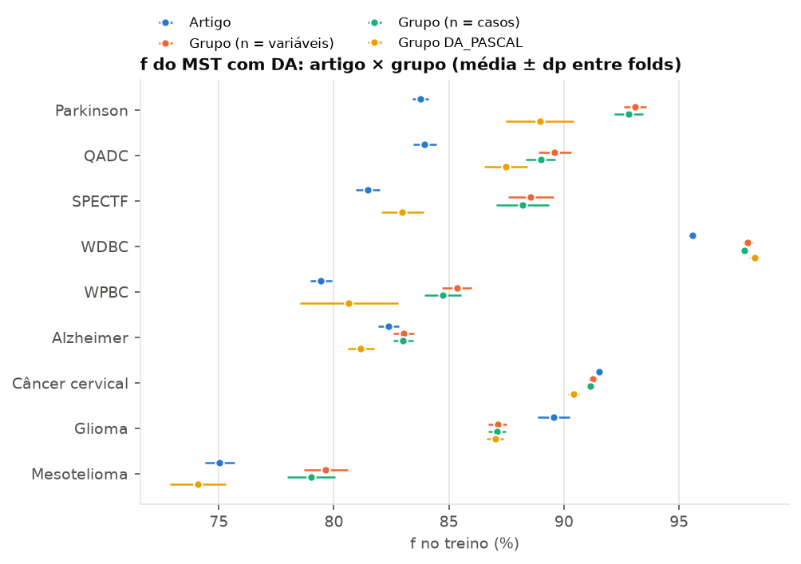
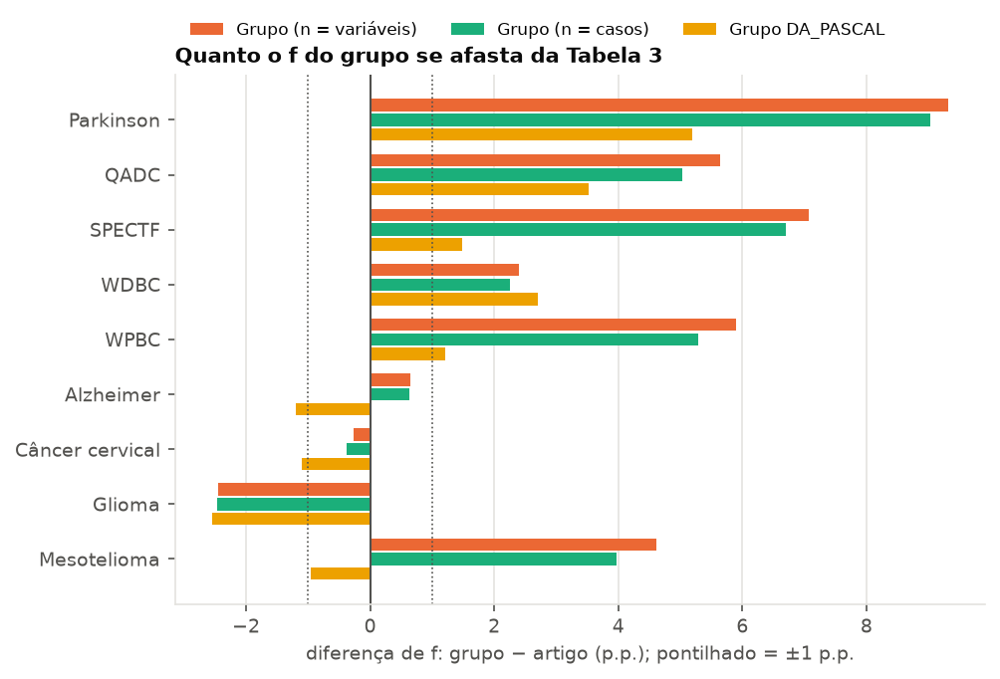
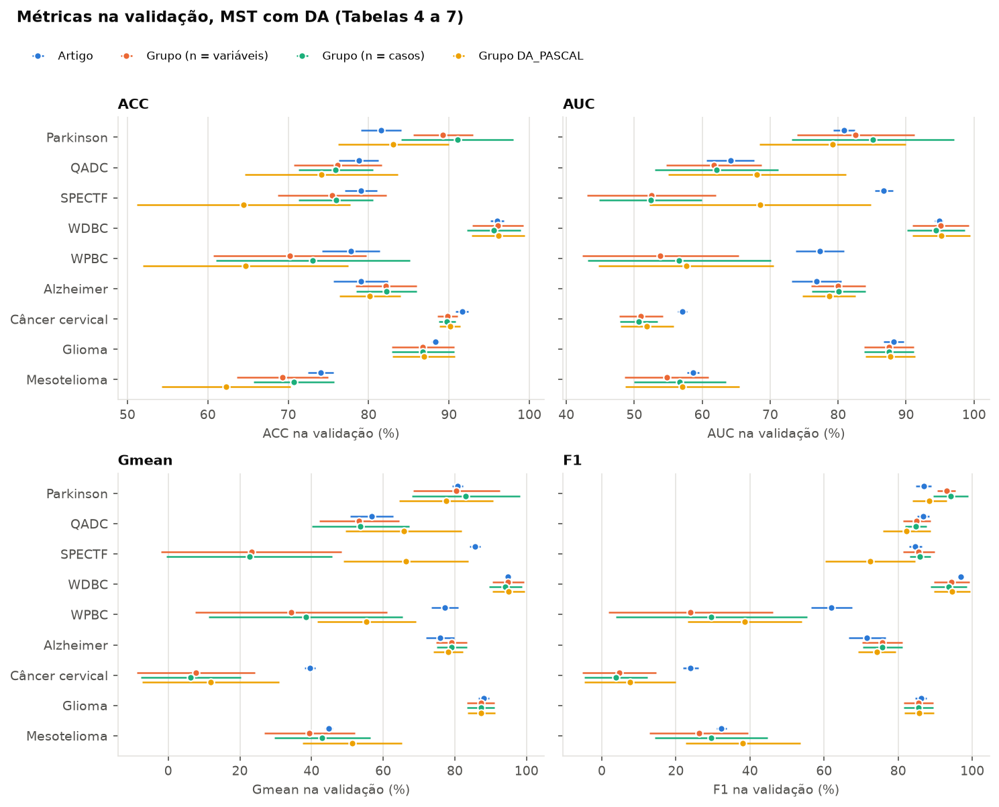
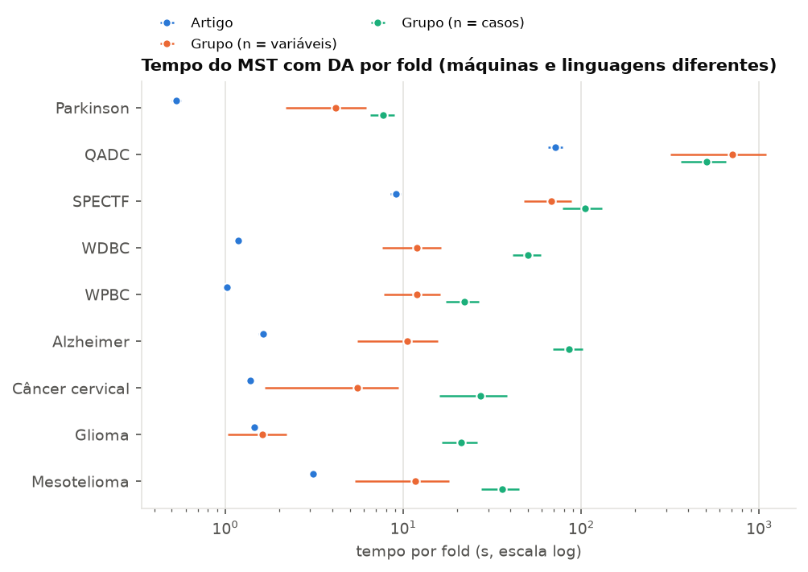
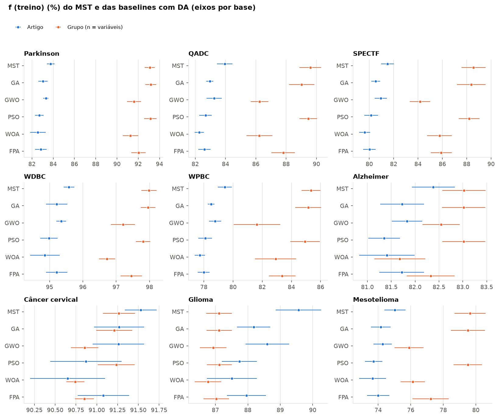
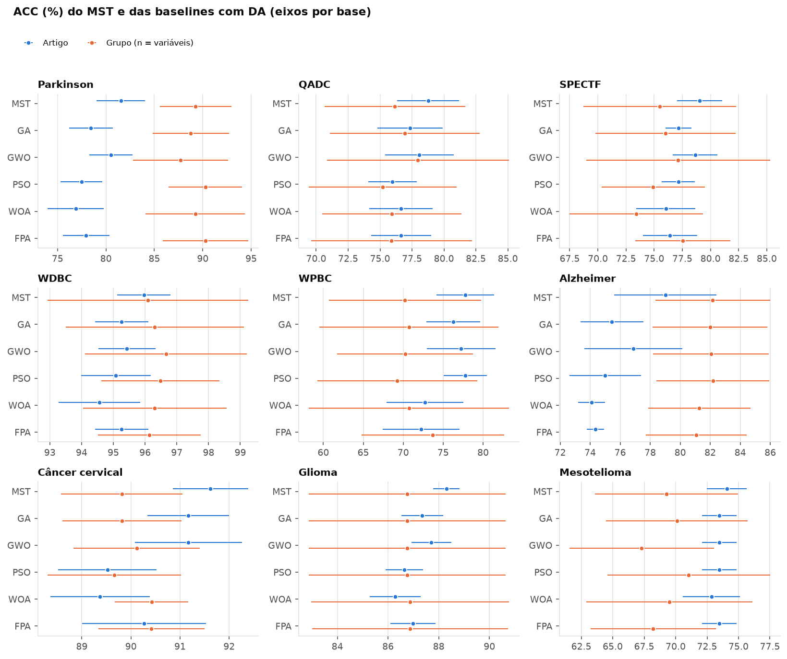
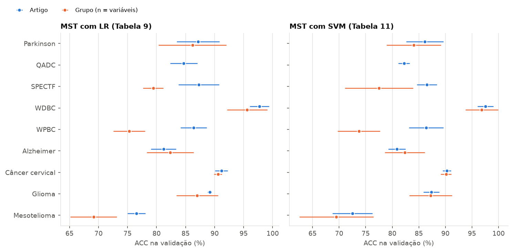
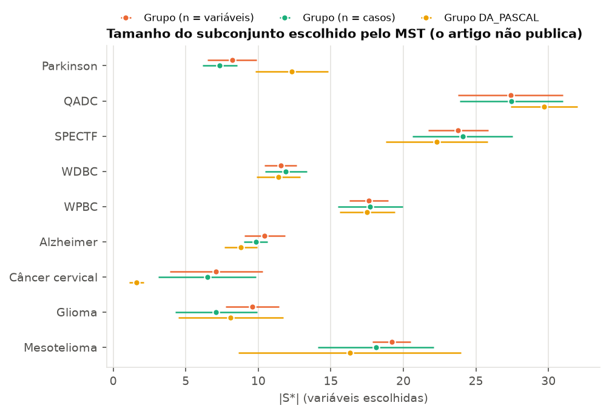

# Comparação com o artigo (Pacheco et al., 2023)

Média ± desvio-padrão entre os 10 folds, como no artigo. Com várias sementes, cada fold entra com a média das suas sementes. Valores em %; tempo em segundos.

## 1. f do MST com DA (Tabela 3)

| base | Artigo | Grupo (n = variáveis) | Grupo (n = casos) | Grupo DA_PASCAL | dif. n = variáveis (p.p.) | dif. n = casos (p.p.) | dif. Grupo DA_PASCAL (p.p.) |
|---|---|---|---|---|---|---|---|
| Parkinson | 83.76 ± 0.36 | 93.08 ± 0.48 | 92.80 ± 0.63 | 88.95 ± 1.48 | +9.32 | +9.04 | +5.19 |
| QADC | 83.95 ± 0.51 | 89.60 ± 0.71 | 88.98 ± 0.63 | 87.47 ± 0.94 | +5.65 | +5.03 | +3.52 |
| SPECTF | 81.49 ± 0.52 | 88.56 ± 0.99 | 88.20 ± 1.13 | 82.97 ± 0.92 | +7.07 | +6.71 | +1.48 |
| WDBC | 95.58 ± 0.16 | 97.98 ± 0.23 | 97.84 ± 0.21 | 98.29 ± 0.22 | +2.40 | +2.26 | +2.71 |
| WPBC | 79.44 ± 0.48 | 85.34 ± 0.64 | 84.73 ± 0.80 | 80.66 ± 2.13 | +5.90 | +5.29 | +1.22 |
| Alzheimer | 82.38 ± 0.45 | 83.02 ± 0.45 | 83.01 ± 0.44 | 81.17 ± 0.58 | +0.64 | +0.63 | -1.21 |
| Câncer cervical | 91.53 ± 0.19 | 91.27 ± 0.19 | 91.15 ± 0.21 | 90.42 ± 0.25 | -0.26 | -0.38 | -1.11 |
| Glioma | 89.56 ± 0.70 | 87.11 ± 0.39 | 87.09 ± 0.39 | 87.01 ± 0.37 | -2.45 | -2.47 | -2.55 |
| Mesotelioma | 75.03 ± 0.64 | 79.65 ± 0.96 | 79.00 ± 1.04 | 74.08 ± 1.22 | +4.62 | +3.97 | -0.95 |

## 2. Métricas na validação, MST com DA (Tabelas 4 a 7)

**ACC**

| base | Artigo | Grupo (n = variáveis) | Grupo (n = casos) | Grupo DA_PASCAL |
|---|---|---|---|---|
| Parkinson | 81.55 ± 2.50 | 89.26 ± 3.70 | 91.04 ± 6.99 | 83.08 ± 6.86 |
| QADC | 78.76 ± 2.44 | 76.16 ± 5.49 | 75.90 ± 4.64 | 74.14 ± 9.52 |
| SPECTF | 79.02 ± 2.01 | 75.49 ± 6.77 | 75.93 ± 4.66 | 64.46 ± 13.24 |
| WDBC | 95.96 ± 0.84 | 96.09 ± 3.16 | 95.57 ± 3.31 | 96.14 ± 3.29 |
| WPBC | 77.76 ± 3.59 | 70.23 ± 9.51 | 73.08 ± 12.04 | 64.68 ± 12.78 |
| Alzheimer | 79.01 ± 3.40 | 82.16 ± 3.82 | 82.23 ± 3.73 | 80.17 ± 3.81 |
| Câncer cervical | 91.62 ± 0.77 | 89.81 ± 1.24 | 89.76 ± 1.02 | 90.12 ± 1.28 |
| Glioma | 88.30 ± 0.52 | 86.75 ± 3.89 | 86.75 ± 3.89 | 86.87 ± 3.87 |
| Mesotelioma | 74.07 ± 1.58 | 69.29 ± 5.69 | 70.72 ± 4.98 | 62.31 ± 8.01 |

**AUC**

| base | Artigo | Grupo (n = variáveis) | Grupo (n = casos) | Grupo DA_PASCAL |
|---|---|---|---|---|
| Parkinson | 80.85 ± 1.56 | 82.60 ± 8.62 | 85.09 ± 11.97 | 79.19 ± 10.78 |
| QADC | 64.15 ± 3.50 | 61.73 ± 7.04 | 62.09 ± 9.10 | 68.06 ± 13.11 |
| SPECTF | 86.72 ± 1.31 | 52.53 ± 9.47 | 52.39 ± 7.55 | 68.49 ± 16.30 |
| WDBC | 94.86 ± 0.66 | 95.10 ± 4.15 | 94.39 ± 4.28 | 95.17 ± 4.23 |
| WPBC | 77.31 ± 3.59 | 53.85 ± 11.50 | 56.62 ± 13.46 | 57.65 ± 12.89 |
| Alzheimer | 76.85 ± 3.67 | 80.03 ± 4.03 | 80.07 ± 3.95 | 78.68 ± 3.89 |
| Câncer cervical | 57.07 ± 0.70 | 50.97 ± 3.22 | 50.68 ± 2.76 | 51.89 ± 3.86 |
| Glioma | 88.19 ± 1.47 | 87.52 ± 3.65 | 87.52 ± 3.65 | 87.70 ± 3.67 |
| Mesotelioma | 58.69 ± 0.88 | 54.76 ± 6.20 | 56.72 ± 6.81 | 57.03 ± 8.40 |

**Gmean**

| base | Artigo | Grupo (n = variáveis) | Grupo (n = casos) | Grupo DA_PASCAL |
|---|---|---|---|---|
| Parkinson | 80.81 ± 1.54 | 80.42 ± 12.11 | 83.03 ± 15.07 | 77.60 ± 13.04 |
| QADC | 56.72 ± 5.98 | 53.30 ± 11.19 | 53.66 ± 13.59 | 65.70 ± 16.14 |
| SPECTF | 85.69 ± 1.52 | 23.20 ± 25.12 | 22.64 ± 23.09 | 66.32 ± 17.45 |
| WDBC | 94.76 ± 0.63 | 94.89 ± 4.47 | 94.14 ± 4.59 | 94.97 ± 4.55 |
| WPBC | 77.20 ± 3.75 | 34.32 ± 26.80 | 38.36 ± 27.10 | 55.39 ± 13.69 |
| Alzheimer | 75.94 ± 3.93 | 79.12 ± 4.34 | 79.15 ± 4.27 | 78.17 ± 4.07 |
| Câncer cervical | 39.55 ± 1.44 | 7.80 ± 16.45 | 6.30 ± 13.94 | 11.88 ± 19.15 |
| Glioma | 88.03 ± 1.49 | 87.24 ± 3.80 | 87.24 ± 3.80 | 87.40 ± 3.80 |
| Mesotelioma | 44.87 ± 1.13 | 39.40 ± 12.65 | 42.99 ± 13.37 | 51.38 ± 13.89 |

**F1**

| base | Artigo | Grupo (n = variáveis) | Grupo (n = casos) | Grupo DA_PASCAL |
|---|---|---|---|---|
| Parkinson | 86.92 ± 2.09 | 93.02 ± 2.39 | 94.19 ± 4.65 | 88.44 ± 4.59 |
| QADC | 86.82 ± 1.62 | 85.03 ± 3.68 | 84.82 ± 2.88 | 82.29 ± 6.47 |
| SPECTF | 84.66 ± 1.73 | 85.53 ± 4.23 | 85.90 ± 2.78 | 72.44 ± 12.15 |
| WDBC | 96.85 ± 0.69 | 94.41 ± 4.75 | 93.63 ± 4.92 | 94.49 ± 4.87 |
| WPBC | 61.98 ± 5.56 | 23.94 ± 22.18 | 29.53 ± 25.81 | 38.51 ± 15.41 |
| Alzheimer | 71.62 ± 4.90 | 75.72 ± 5.46 | 75.77 ± 5.36 | 74.34 ± 5.07 |
| Câncer cervical | 23.97 ± 2.13 | 4.72 ± 9.98 | 3.83 ± 8.54 | 7.58 ± 12.30 |
| Glioma | 86.14 ± 1.55 | 85.47 ± 3.96 | 85.47 ± 3.96 | 85.65 ± 3.96 |
| Mesotelioma | 32.31 ± 1.32 | 26.18 ± 13.27 | 29.56 ± 15.24 | 38.07 ± 15.47 |

## 3. Tempo do MST com DA por fold (Tabela 2)

Artigo: Object-Pascal (Delphi 10.3), Intel i9-10920X. Grupo, n = variáveis: MST do E2-P1-tempo (Python, código rápido da LDA, Ryzen 9 7950X, 16 processos). Grupo, n = casos: E1-casos (Python, código rápido, Ryzen 9 7950X com 31 processos em 16 núcleos). Comparação só qualitativa.

| base | Artigo | Grupo (n = variáveis) | Grupo (n = casos) |
|---|---|---|---|
| Parkinson | 0.53 ± 0.03 | 4.18 ± 1.99 | 7.68 ± 1.18 |
| QADC | 71.75 ± 6.49 | 706.54 ± 389.99 | 506.21 ± 143.02 |
| SPECTF | 9.09 ± 0.62 | 67.47 ± 20.10 | 104.78 ± 25.93 |
| WDBC | 1.19 ± 0.02 | 11.94 ± 4.32 | 50.25 ± 8.92 |
| WPBC | 1.02 ± 0.04 | 11.98 ± 4.19 | 21.99 ± 4.59 |
| Alzheimer | 1.63 ± 0.09 | 10.56 ± 5.05 | 85.52 ± 16.31 |
| Câncer cervical | 1.39 ± 0.02 | 5.51 ± 3.85 | 27.04 ± 11.15 |
| Glioma | 1.46 ± 0.06 | 1.62 ± 0.58 | 21.21 ± 4.71 |
| Mesotelioma | 3.12 ± 0.10 | 11.73 ± 6.39 | 35.99 ± 8.63 |

## 4. MST × baselines com DA (Tabelas 3 a 8)

**f (treino)** (artigo / grupo)

| base | MST | GA | GWO | PSO | WOA | FPA |
|---|---|---|---|---|---|---|
| Parkinson | 83.76 / 93.08 | 83.04 / 93.17 | 83.31 / 91.60 | 82.69 / 93.15 | 82.56 / 91.27 | 82.84 / 92.03 |
| QADC | 83.95 / 89.60 | 82.96 / 89.03 | 83.25 / 86.24 | 82.68 / 89.46 | 82.27 / 86.23 | 82.60 / 87.80 |
| SPECTF | 81.49 / 88.56 | 80.53 / 88.37 | 80.94 / 84.16 | 80.15 / 88.21 | 79.63 / 85.77 | 80.01 / 85.91 |
| WDBC | 95.58 / 97.98 | 95.21 / 97.96 | 95.35 / 97.20 | 94.98 / 97.81 | 94.86 / 96.73 | 95.21 / 97.46 |
| WPBC | 79.44 / 85.34 | 78.50 / 85.15 | 78.77 / 81.64 | 78.10 / 84.93 | 77.73 / 82.91 | 77.99 / 83.37 |
| Alzheimer | 82.38 / 83.02 | 81.73 / 83.01 | 81.83 / 82.54 | 81.35 / 83.02 | 81.41 / 81.68 | 81.72 / 82.32 |
| Câncer cervical | 91.53 / 91.27 | 91.27 / 91.21 | 91.26 / 90.85 | 90.87 / 91.24 | 90.65 / 90.74 | 91.08 / 90.85 |
| Glioma | 89.56 / 87.11 | 88.18 / 87.12 | 88.60 / 86.93 | 87.74 / 87.12 | 87.51 / 86.77 | 87.96 / 87.03 |
| Mesotelioma | 75.03 / 79.65 | 74.16 / 79.51 | 74.27 / 75.90 | 73.72 / 79.51 | 73.66 / 76.12 | 74.00 / 77.22 |

**ACC** (artigo / grupo)

| base | MST | GA | GWO | PSO | WOA | FPA |
|---|---|---|---|---|---|---|
| Parkinson | 81.55 / 89.26 | 78.45 / 88.76 | 80.50 / 87.71 | 77.47 / 90.26 | 76.89 / 89.24 | 77.95 / 90.29 |
| QADC | 78.76 / 76.16 | 77.34 / 76.93 | 78.07 / 77.97 | 75.96 / 75.21 | 76.64 / 75.92 | 76.65 / 75.90 |
| SPECTF | 79.02 / 75.49 | 77.15 / 76.01 | 78.63 / 77.14 | 77.14 / 74.91 | 76.03 / 73.40 | 76.41 / 77.54 |
| WDBC | 95.96 / 96.09 | 95.26 / 96.31 | 95.43 / 96.66 | 95.08 / 96.48 | 94.56 / 96.31 | 95.26 / 96.13 |
| WPBC | 77.76 / 70.23 | 76.26 / 70.71 | 77.26 / 70.24 | 77.76 / 69.24 | 72.74 / 70.71 | 72.24 / 73.71 |
| Alzheimer | 79.01 / 82.16 | 75.45 / 81.98 | 76.87 / 82.05 | 75.00 / 82.17 | 74.10 / 81.27 | 74.35 / 81.08 |
| Câncer cervical | 91.62 / 89.81 | 91.17 / 89.82 | 91.17 / 90.12 | 89.52 / 89.67 | 89.37 / 90.42 | 90.27 / 90.42 |
| Glioma | 88.30 / 86.75 | 87.35 / 86.75 | 87.71 / 86.75 | 86.64 / 86.75 | 86.28 / 86.87 | 86.99 / 86.87 |
| Mesotelioma | 74.07 / 69.29 | 73.47 / 70.09 | 73.47 / 67.30 | 73.47 / 71.03 | 72.85 / 69.50 | 73.47 / 68.22 |

**AUC** (artigo / grupo)

| base | MST | GA | GWO | PSO | WOA | FPA |
|---|---|---|---|---|---|---|
| Parkinson | 80.85 / 82.60 | 78.77 / 81.60 | 80.15 / 80.90 | 78.13 / 83.26 | 77.73 / 81.04 | 78.44 / 83.29 |
| QADC | 64.15 / 61.73 | 64.10 / 63.89 | 63.71 / 64.68 | 61.33 / 60.44 | 62.67 / 62.36 | 62.76 / 61.77 |
| SPECTF | 86.72 / 52.53 | 85.55 / 52.40 | 86.48 / 54.62 | 85.54 / 50.07 | 84.85 / 51.51 | 85.09 / 53.18 |
| WDBC | 94.86 / 95.10 | 94.22 / 95.37 | 94.44 / 95.76 | 94.07 / 95.60 | 93.17 / 95.48 | 94.22 / 95.04 |
| WPBC | 77.31 / 53.85 | 75.65 / 54.17 | 76.31 / 50.92 | 77.31 / 51.60 | 69.75 / 55.08 | 68.50 / 55.50 |
| Alzheimer | 76.85 / 80.03 | 73.08 / 79.83 | 74.60 / 79.83 | 72.65 / 80.02 | 71.66 / 79.28 | 71.90 / 79.09 |
| Câncer cervical | 57.07 / 50.97 | 55.99 / 50.97 | 56.90 / 49.75 | 55.66 / 50.88 | 53.91 / 49.92 | 55.99 / 51.18 |
| Glioma | 88.19 / 87.52 | 87.16 / 87.52 | 86.77 / 87.56 | 86.62 / 87.52 | 87.05 / 87.66 | 87.16 / 87.66 |
| Mesotelioma | 58.69 / 54.76 | 58.25 / 55.68 | 58.25 / 52.62 | 58.25 / 56.23 | 57.81 / 54.68 | 58.25 / 53.08 |

**Gmean** (artigo / grupo)

| base | MST | GA | GWO | PSO | WOA | FPA |
|---|---|---|---|---|---|---|
| Parkinson | 80.81 / 80.42 | 78.75 / 79.27 | 80.14 / 78.76 | 78.10 / 81.04 | 77.67 / 78.50 | 78.41 / 80.98 |
| QADC | 56.72 / 53.30 | 57.94 / 57.17 | 56.47 / 57.30 | 53.60 / 51.72 | 55.65 / 54.56 | 55.90 / 53.51 |
| SPECTF | 85.69 / 23.20 | 84.32 / 23.88 | 85.41 / 27.29 | 84.31 / 16.65 | 83.47 / 27.05 | 83.75 / 17.66 |
| WDBC | 94.76 / 94.89 | 94.12 / 95.21 | 94.36 / 95.60 | 93.99 / 95.47 | 92.99 / 95.32 | 94.12 / 94.89 |
| WPBC | 77.20 / 34.32 | 75.51 / 37.81 | 76.18 / 23.86 | 77.22 / 30.86 | 69.20 / 40.34 | 67.83 / 35.73 |
| Alzheimer | 75.94 / 79.12 | 71.94 / 78.91 | 73.57 / 78.86 | 71.53 / 79.10 | 70.45 / 78.46 | 70.68 / 78.24 |
| Câncer cervical | 39.55 / 7.80 | 35.44 / 7.80 | 39.49 / 0.00 | 35.30 / 7.80 | 27.17 / 0.00 | 35.44 / 7.56 |
| Glioma | 88.03 / 87.24 | 86.97 / 87.24 | 86.60 / 87.28 | 86.47 / 87.24 | 86.86 / 87.38 | 86.97 / 87.37 |
| Mesotelioma | 44.87 / 39.40 | 44.68 / 41.18 | 44.68 / 35.76 | 44.68 / 39.51 | 44.47 / 35.43 | 44.68 / 35.07 |

**F1** (artigo / grupo)

| base | MST | GA | GWO | PSO | WOA | FPA |
|---|---|---|---|---|---|---|
| Parkinson | 86.92 / 93.02 | 84.39 / 92.72 | 86.10 / 91.99 | 83.58 / 93.73 | 83.04 / 93.19 | 83.97 / 93.81 |
| QADC | 86.82 / 85.03 | 85.72 / 85.38 | 86.34 / 86.16 | 84.97 / 84.44 | 85.34 / 84.76 | 85.34 / 84.86 |
| SPECTF | 84.66 / 85.53 | 83.11 / 85.91 | 84.35 / 86.54 | 83.09 / 85.35 | 82.11 / 84.07 | 82.44 / 86.99 |
| WDBC | 96.85 / 94.41 | 96.29 / 94.77 | 96.43 / 95.26 | 96.15 / 95.06 | 95.79 / 94.81 | 96.29 / 94.55 |
| WPBC | 61.98 / 23.94 | 59.70 / 25.71 | 60.82 / 15.49 | 61.88 / 19.21 | 52.37 / 28.97 | 50.91 / 25.86 |
| Alzheimer | 71.62 / 75.72 | 66.64 / 75.44 | 68.67 / 75.42 | 66.13 / 75.70 | 64.80 / 74.77 | 65.09 / 74.52 |
| Câncer cervical | 23.97 / 4.72 | 21.02 / 4.72 | 23.39 / 0.00 | 19.89 / 4.72 | 14.16 / 0.00 | 21.02 / 5.00 |
| Glioma | 86.14 / 85.47 | 85.01 / 85.47 | 84.60 / 85.51 | 84.45 / 85.47 | 84.90 / 85.63 | 85.01 / 85.61 |
| Mesotelioma | 32.31 / 26.18 | 31.79 / 27.64 | 31.79 / 22.71 | 31.79 / 28.08 | 31.36 / 24.81 | 31.79 / 22.24 |

**Vitórias/empates/derrotas do MST** (t pareado bicaudal, 5%, nos folds; artigo → grupo)

| medida | GA | GWO | PSO | WOA | FPA |
|---|---|---|---|---|---|
| f (treino) | 9/0/0 → 1/8/0 | 9/0/0 → 9/0/0 | 9/0/0 → 2/7/0 | 9/0/0 → 9/0/0 | 9/0/0 → 9/0/0 |
| ACC | 7/2/0 → 0/9/0 | 4/5/0 → 0/9/0 | 7/2/0 → 0/9/0 | 9/0/0 → 1/8/0 | 8/1/0 → 0/9/0 |
| AUC | 7/2/0 → 0/9/0 | 4/5/0 → 0/9/0 | 8/1/0 → 0/9/0 | 8/1/0 → 0/9/0 | 8/1/0 → 0/9/0 |
| Gmean | 6/3/0 → 0/9/0 | 3/6/0 → 0/9/0 | 7/2/0 → 0/9/0 | 7/2/0 → 0/9/0 | 7/2/0 → 0/9/0 |
| F1 | 7/2/0 → 0/9/0 | 3/6/0 → 0/9/0 | 7/2/0 → 0/9/0 | 9/0/0 → 1/8/0 | 8/1/0 → 0/9/0 |

## 5. MST com LR e SVM: ACC na validação (Tabelas 9 e 11)

| base | LR artigo | LR grupo | SVM artigo | SVM grupo |
|---|---|---|---|---|
| Parkinson | 87.16 ± 3.66 | 86.18 ± 5.85 | 86.13 ± 3.49 | 84.08 ± 5.12 |
| QADC | 84.68 ± 2.33 | — | 82.23 ± 1.07 | — |
| SPECTF | 87.29 ± 3.50 | 79.42 ± 1.75 | 86.52 ± 1.86 | 77.51 ± 6.39 |
| WDBC | 97.71 ± 1.68 | 95.60 ± 3.46 | 97.53 ± 1.50 | 96.84 ± 3.07 |
| WPBC | 86.39 ± 2.25 | 75.26 ± 2.72 | 86.39 ± 3.26 | 73.74 ± 3.98 |
| Alzheimer | 81.20 ± 2.15 | 82.37 ± 4.04 | 80.88 ± 1.64 | 82.37 ± 3.73 |
| Câncer cervical | 91.17 ± 1.09 | 90.57 ± 0.70 | 90.27 ± 0.76 | 90.12 ± 1.02 |
| Glioma | 89.15 ± 0.37 | 86.99 ± 3.58 | 87.37 ± 1.50 | 87.23 ± 3.99 |
| Mesotelioma | 76.54 ± 1.55 | 69.15 ± 3.99 | 72.52 ± 3.75 | 69.49 ± 6.97 |

## 6. Tamanho de S* (não publicado no artigo)

| base | m | Grupo (n = variáveis) | Grupo (n = casos) | Grupo DA_PASCAL |
|---|---|---|---|---|
| Parkinson | 22 | 8.20 ± 1.69 | 7.34 ± 1.19 | 12.30 ± 2.50 |
| QADC | 67 | 27.38 ± 3.61 | 27.44 ± 3.56 | 29.70 ± 2.31 |
| SPECTF | 44 | 23.78 ± 2.08 | 24.08 ± 3.45 | 22.30 ± 3.53 |
| WDBC | 30 | 11.54 ± 1.10 | 11.90 ± 1.44 | 11.40 ± 1.51 |
| WPBC | 31 | 17.62 ± 1.34 | 17.72 ± 2.23 | 17.50 ± 1.90 |
| Alzheimer | 28 | 10.44 ± 1.41 | 9.82 ± 0.80 | 8.80 ± 1.14 |
| Câncer cervical | 28 | 7.10 ± 3.21 | 6.48 ± 3.38 | 1.60 ± 0.52 |
| Glioma | 23 | 9.60 ± 1.84 | 7.10 ± 2.81 | 8.10 ± 3.60 |
| Mesotelioma | 33 | 19.20 ± 1.32 | 18.10 ± 4.01 | 16.30 ± 7.67 |
